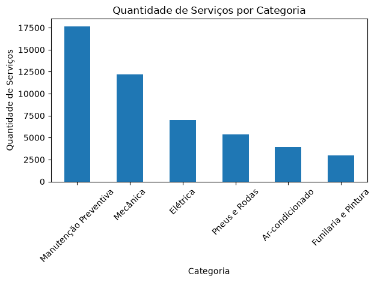
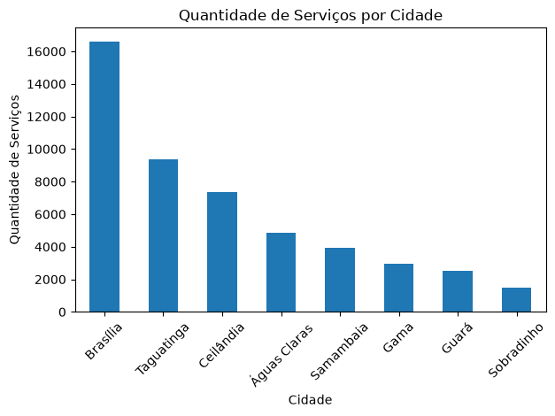
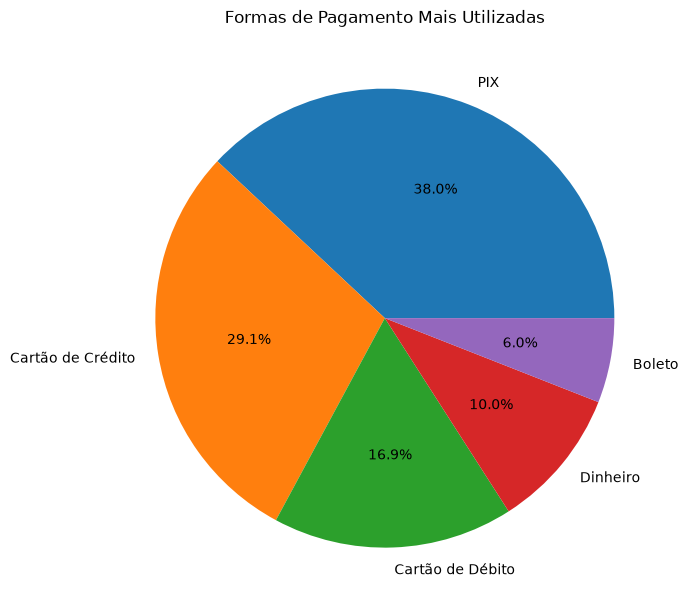
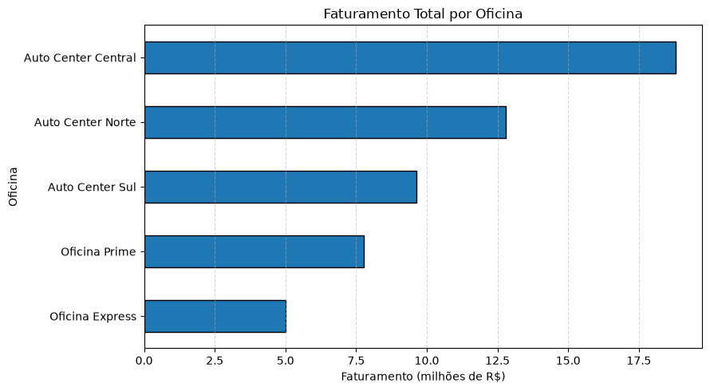
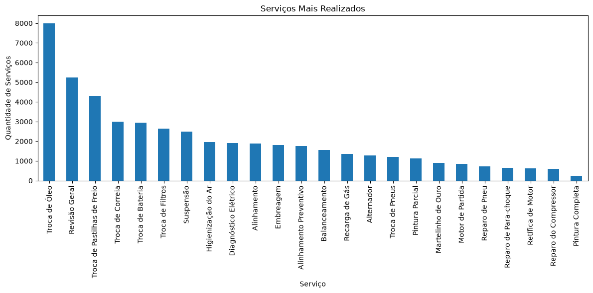
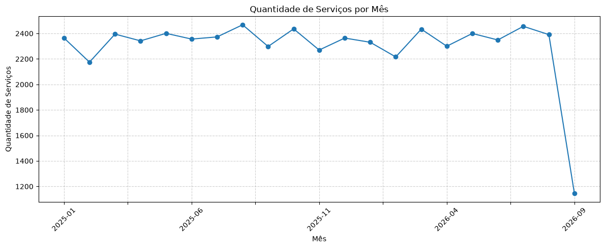

# ETL e Visualização de Dados — Rede de Oficinas Automotivas

Pipeline de ETL e análise exploratória em Python sobre uma base de **50.000 ordens de serviço** de uma rede de oficinas do Distrito Federal. Peguei uma planilha Excel com vários problemas de qualidade, limpei e padronizei os dados e respondi a perguntas de negócio com gráficos.

> Projeto prático da disciplina de Ciência de Dados — Bacharelado em Ciência de Dados e Machine Learning (UniCEUB).

**Fluxo:** IMPORTAR → LIMPAR → PADRONIZAR → ANALISAR → VISUALIZAR

## Destaques

- Tratei **5 tipos de problema de qualidade** em uma base de 50 mil linhas.
- Cheguei a uma base final de **49.055 registros válidos**.
- Calculei o faturamento por oficina: cerca de **R$ 54 milhões** no total, e o **Auto Center Central** sozinho responde por cerca de R$ 18,8 milhões.
- Vi que a demanda é estável, entre **2.200 e 2.500 serviços/mês**, sem sazonalidade forte.

## Cenário

Neste projeto atuo como Analista de Dados Júnior de uma rede de oficinas. A empresa enviou uma planilha com 11 colunas (`id_ordem`, `data_servico`, `cliente`, `cidade`, `oficina`, `categoria`, `servico`, `tipo_veiculo`, `valor_servico`, `quantidade`, `forma_pagamento`), mas a base estava "suja".

## Tratamento dos dados (ETL)

| Problema encontrado | Ocorrências | Como tratei |
| --- | --- | --- |
| Linhas totalmente vazias | 300 | `dropna(how="all")` |
| Cidades escritas de jeitos diferentes (`" Brasília "`, `BRASÍLIA`, `brasília`) | 8 cidades padronizadas | `str.strip()` + `str.lower().str.title()` |
| Valores como texto no padrão brasileiro (`"R$ 1.118,50"`) | coluna inteira | removi `R$` e o ponto de milhar, troquei vírgula por ponto e converti com `pd.to_numeric` |
| Datas inválidas (`"data inválida"`) | 800 | `pd.to_datetime(..., dayfirst=True, errors="coerce")` → `NaT` |
| Registros duplicados | 645 | `drop_duplicates()` |
| Quantidades negativas (-1, -2, -3) | 581 | `abs()`, porque o padrão indica erro de sinal na digitação |

## Perguntas e resultados

| Pergunta | Resposta |
| --- | --- |
| Qual categoria tem mais serviços? | **Manutenção Preventiva** (17.634), seguida de Mecânica (12.215) |
| Quais serviços são mais realizados? | **Troca de Óleo** (7.989), Revisão Geral (5.238) e Troca de Pastilhas de Freio (4.297) |
| Onde há mais serviços? | **Brasília** (16.615), Taguatinga (9.355) e Ceilândia (7.355) |
| Forma de pagamento mais usada? | **PIX** (~38%), seguido do Cartão de Crédito (~29%) |
| Qual oficina fatura mais? | **Auto Center Central** (~R$ 18,8 mi); a Oficina Express fatura menos (~R$ 5 mi) |
| A demanda varia ao longo dos meses? | Não muito: fica estável entre 2.200 e 2.500/mês. Setembro/2026 está incompleto porque a base termina em 15/09 |

### Gráficos

| | |
| --- | --- |
|  |  |
|  |  |





## Tecnologias

- Python 3
- Pandas (leitura do Excel, limpeza, `groupby`, conversão de tipos)
- Matplotlib (gráficos de barras, barras horizontais, pizza e linha)
- Jupyter Notebook

## Estrutura do repositório

```
analise-oficinas-etl/
├── prova_oficinas_etl.ipynb   # notebook com todo o ETL, análises e gráficos comentados
├── data/
│   └── Dataset_Prova_Oficinas_50mil.xlsx
├── images/                    # gráficos exportados do notebook
└── requirements.txt
```

## Como executar

```bash
git clone https://github.com/vitorcalasans-tech/analise-oficinas-etl.git
cd analise-oficinas-etl
pip install -r requirements.txt
jupyter notebook prova_oficinas_etl.ipynb
```

Também dá para abrir no Google Colab: basta enviar o notebook e a pasta `data/`.

## Autor

**Vítor Calasans** — estudante de Ciência de Dados e Machine Learning (UniCEUB)
[github.com/vitorcalasans-tech](https://github.com/vitorcalasans-tech)
